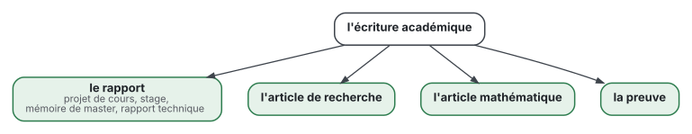

# Écriture académique

[](https://github.com/Tewf/reader-ergonomics-academic/actions/workflows/checks.yml?query=branch%3Amaster)
[](https://tewf.github.io/reader-ergonomics-academic/)

Comment écrire un rapport, un article de recherche, un article mathématique ou une preuve qui respecte les conventions
académiques et coûte au lecteur le moins possible.

Ce dépôt étend [reader-ergonomics](https://github.com/Tewf/reader-ergonomics). Les principes, leurs niveaux de preuve
et les vérifications y vivent et ne sont pas répétés ici. Ce dépôt n'ajoute que ce qui est propre à ces genres : leurs
preuves et les formes de leurs documents. Quand une convention académique et un principe du standard divergent, la
forme dit lequel l'emporte, et pourquoi.

> **État :** en cours. Trois revues multivocales sont écrites et auditées dans [evidence/](evidence/) : les articles
> de recherche et l'écriture mathématique, auditées le 2026-10-28, et les rapports. Chacune des quatre formes a un
> squelette, une version LaTeX et un exemple rédigé ; la forme d'un rapport est une première version. C'est une lecture informelle
> de la recherche et de la pratique publiées : pas un standard officiel, pas une étude relue par des pairs, pas un
> résultat nouveau, et pas une prétention à l'état de l'art.
>
> **Comment il est fait :** avec Claude, un assistant IA d'Anthropic, sous la direction du mainteneur, comme
> reader-ergonomics. Des agents IA rédigent les revues de littérature ; chaque référence est résolue par programme, et
> un chiffre lu seulement dans un résumé est marqué « (secondary) ». Les corrections sont bienvenues en issues.

## Portée

Quatre sortes de documents, chacune avec ses preuves et sa forme ; les sortes de rapport, du projet de cours au mémoire, sont
définies dans le [cadre de la revue sur les rapports](evidence/reports/frame.md) :

```dot
// The kinds of l&#39;écriture académique this repository gives a shape to: the figure of README.fr.md.
digraph scope {
  graph [rankdir=TB, nodesep=0.4, ranksep=0.5, bgcolor="white", pad=0.2, fontname="Inter"];
  node  [shape=box, style="rounded,filled", fontname="Inter", fontsize=13, margin="0.2,0.1", penwidth=1.5, fontcolor="#1F2328"];
  edge  [fontname="Inter", fontsize=11, color="#3D434B", fontcolor="#55575F", penwidth=1.3, arrowsize=0.8];
  AW [label=<<b>l&#39;écriture académique</b>>, fillcolor="#FFFFFF", color="#3D434B"];
  RP [label=<<b>le rapport</b><br/><font point-size="11" color="#55575F">projet de cours, stage,</font><br/><font point-size="11" color="#55575F">mémoire de master, rapport technique</font>>, fillcolor="#E6F2EA", color="#2E7D4F"];
  PA [label=<<b>l&#39;article de recherche</b>>, fillcolor="#E6F2EA", color="#2E7D4F"];
  MA [label=<<b>l&#39;article mathématique</b>>, fillcolor="#E6F2EA", color="#2E7D4F"];
  PF [label=<<b>la preuve</b>>, fillcolor="#E6F2EA", color="#2E7D4F"];
  AW -> RP;
  AW -> PA;
  AW -> MA;
  AW -> PF;
  {rank=same; RP; PA; MA; PF}
}
```



<details>
<summary>Source Graphviz</summary>



</details>

## Contenu

| Partie | Contient | État |
|---|---|---|
| [standard.md](standard.md) | la fiche : comment utiliser ce standard, et quelle forme pour quel document | écrit |
| [AGENTS.md](AGENTS.md) | comment modifier ce dépôt, pour une personne ou un modèle de langage | écrit |
| [evidence/](evidence/) | trois revues : les articles de recherche, l'écriture mathématique, et les rapports (ligne suivante) | écrites, auditées |
| [evidence/reports/](evidence/reports/) | le rapport comme genre : ses normes, ses lecteurs et ses examinateurs, et les conflits entre la convention académique et le standard | écrite, auditée ; une seconde passe sur les examinateurs en cours d'intégration |
| [shapes/](shapes/) | les squelettes d'un article de recherche, d'un article mathématique et d'une preuve, chacun avec un exemple rédigé | écrits |
| [shapes/academic-report](shapes/academic-report.md) | un gabarit pour les quatre sortes de rapport, titres en français et en anglais | première version, avec un exemple rédigé de rapport technique ; sa structure a été essayée une fois sur un rapport de projet de cours privé, non publié ici |

Les présentations sont nées ici et ont rejoint un dépôt à elles,
[reader-ergonomics-presentations](https://github.com/Tewf/reader-ergonomics-presentations), le 2026-10-29 : les deux revues partageaient 2 travaux sur 370.

## Le vérifier

```sh
git clone https://github.com/Tewf/reader-ergonomics
python3 reader-ergonomics/checks/run.py chemin/vers/ce/dépôt
```

La CI exécute les mêmes vérifications à chaque push, et une exécution échoue sur toute erreur
([checks.yml](https://github.com/Tewf/reader-ergonomics-academic/blob/master/.github/workflows/checks.yml)). Le badge en
haut est le dernier résultat sur master : la preuve que ce dépôt respecte le standard qu'il étend. Chaque push sur
master construit aussi le site, [tewf.github.io/reader-ergonomics-academic](https://tewf.github.io/reader-ergonomics-academic/)
([pages.yml](https://github.com/Tewf/reader-ergonomics-academic/blob/master/.github/workflows/pages.yml)).

## Licence

Code sous [Apache License 2.0](LICENSE) ; texte sous [CC BY 4.0](LICENSES/CC-BY-4.0.txt). Réutilisez-le comme vous le
souhaitez, en citant ce dépôt ; [CITATION.cff](CITATION.cff) donne une citation si besoin.

La version anglaise, [README.md](README.md), fait foi.
