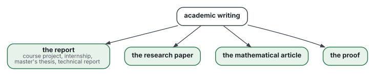

# Academic writing

[](https://github.com/Tewf/reader-ergonomics-academic/actions/workflows/checks.yml?query=branch%3Amaster)
[](https://tewf.github.io/reader-ergonomics-academic/)

How to write a report, a research paper, a mathematical article or a proof that meets academic conventions and costs
the reader as little as possible.

It extends [reader-ergonomics](https://github.com/Tewf/reader-ergonomics). The principles, their grades and the checks
live there and are not repeated here. This repository adds only what is particular to these genres: their evidence,
and the shapes of their documents. Where an academic convention and a principle of the standard disagree, the shape
says which one wins, and why.

> **Status:** work in progress. Two multivocal reviews are written in [evidence/](evidence/), and their numbers were
> audited on 2026-10-28; a third, on reports, is written and audited. The shapes of a paper, an article and a proof exist;
> the shape of a report is a first draft. It is an informal reading of published research and practice: not an
> official standard, not a peer-reviewed study, not a new result, and not a claim to the state of the art.
>
> **How it is made:** with Claude, an AI assistant by Anthropic, under the maintainer's direction, the way
> reader-ergonomics was made. AI agents draft the literature reviews; every reference is resolved by script, and a
> number read only in a summary is marked "(secondary)". Corrections are welcome as issues.

## Scope

Four kinds of document, each with its own evidence and its own shape:



## Contents

| Part | Holds | State |
|---|---|---|
| [evidence/](evidence/) | two reviews: research papers, mathematical writing | written, audited |
| [evidence/reports/](evidence/reports/) | the report as a genre: its standards, its readers and examiners, and where academic convention and the standard conflict | written, audited; a second pass on examiners being merged |
| [shapes/](shapes/) | the skeletons of a research paper, a mathematical article and a proof | written |
| [shapes/academic-report](shapes/academic-report.md) | one template for the four kinds of report, headings in French and English | first draft; tested once, for structure, on a course project report |

Presentations began here and moved to a repository of their own,
[reader-ergonomics-presentations](https://github.com/Tewf/reader-ergonomics-presentations), on 2026-10-29: the two reviews shared 2 of 370 works.

## Check it

```sh
git clone https://github.com/Tewf/reader-ergonomics
python3 reader-ergonomics/checks/run.py path/to/this/repository
```

CI runs the same checks on every push, and a run fails on any error
([checks.yml](https://github.com/Tewf/reader-ergonomics-academic/blob/master/.github/workflows/checks.yml)). The badge at the top
is the last result on master: the proof that this repository obeys the standard it extends. Every push to master also
renders the site, [tewf.github.io/reader-ergonomics-academic](https://tewf.github.io/reader-ergonomics-academic/)
([pages.yml](https://github.com/Tewf/reader-ergonomics-academic/blob/master/.github/workflows/pages.yml)).

## Licence

Code under the [Apache License 2.0](LICENSE); prose under [CC BY 4.0](LICENSES/CC-BY-4.0.txt). Reuse it as you wish, with
credit to this repository; [CITATION.cff](CITATION.cff) gives a citation if you need one.
