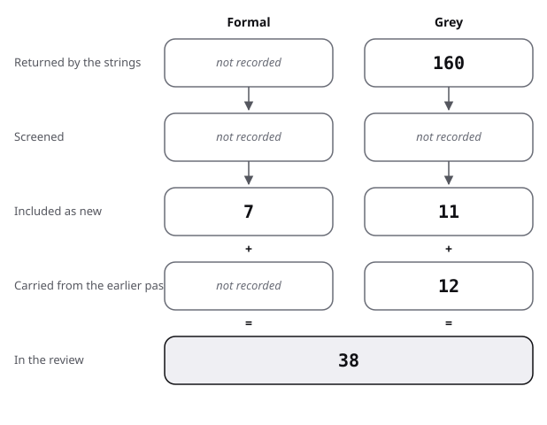

# Sources: the pool, its flow and its quality scores

This file lists every source of the review, how it was found, and its quality; the method is in protocol.md.

## Flow of the grey search

| Stage | Formal | Grey |
|---|---|---|
| Returned by the strings | not recorded | 160 |
| Screened | not recorded | not recorded |
| Included as new | 7 | 11 |
| Carried from the earlier pass | not recorded | 12 |
| In the review | 15 | 23 |

- Formal:
  - The formal pool was built by narrative search and snowballing before the protocol existed, so no count of returned or screened records exists.
  - Semantic Scholar gave a total for each of nine strings (see the protocol), and OpenAlex gave none.
  - 7 new formal items came from the search for existing reviews (strand 0 of review.md), and Uskuplu 2026 was added besides.
- Grey:
  - 160 results were listed by 9 web strings, 4 API queries and the Tao reading list.
  - 21 were opened and read in full or in the relevant part.
  - 11 were included as new (Lee 2005, Georgakopoulos 2023, Ramdas 2026, Cohn 2026, Tao 2026c, LMS 2021, EMS 2026, Mathlib 2026, Stanford 2023, Ilmavirta 2015, MathOverflow 2021).
  - Cohn 2026 came by snowballing, from Tao's reading list.
  - 12 were already in the review and were scored now, which gives 23 grey sources scored, 4 of them below 10 of 20 (arXiv 2026, Serre 2003, Stanford 2023, MathOverflow 2021).
  - Excluded: 4 unreachable pages (not read), 2 off the question (Pak, the 2016 LMS process guide) and 1 that only pointed to others (MathOverflow 506032).

In the review: the mathematical writing source rows of each kind, counted by script.

The figure draws the stages of the table for mathematical writing.

## Grey sources, scored on 20 criteria

Columns A to T are the eight groups of criteria defined in the [method](../README.md#method). Impact is 0.5 where no count was taken.

| Key | Kind | Found via | A | M | O | D | P | N | I | T | Total | Used in |
|---|---|---|---|---|---|---|---|---|---|---|---|---|
| Krantz 2017 | grey tier 1 | existing | 4 | 4 | 1.5 | 1 | 1 | 1 | 1 | 1 | 14.5 | review 1 |
| AMS 2017 | grey tier 1 | existing | 3.5 | 3.5 | 2.5 | 1 | 0.5 | 1 | 1 | 1 | 14 | review 2, baseline |
| Knuth 1989 | grey tier 1 | existing | 4 | 3 | 1.5 | 1 | 1 | 1 | 1 | 1 | 13.5 | review 0, 1 |
| Higham 2020 | grey tier 1 | existing | 4 | 3 | 1.5 | 1 | 1 | 0.5 | 1 | 1 | 13 | review 1 (secondary) |
| Georgakopoulos 2023 | grey tier 2 | G5 | 4 | 3.5 | 1.5 | 1 | 0.5 | 1.5 | 0.5 | 0.5 | 13 | review 1.1 |
| Massot 2026 | grey tier 2 | existing | 3.5 | 3.5 | 3 | 0.5 | 0.5 | 1 | 1 | 0.5 | 13.5 | review 6 |
| Tao 2023 | grey tier 3 | existing | 3 | 4.5 | 3 | 1 | 1 | 1.5 | 1 | 0 | 15 | review 6 |
| Ilmavirta 2015 | grey tier 2 | M1 | 3.5 | 2.5 | 2 | 1 | 0.5 | 1.5 | 0.5 | 0.5 | 12 | review 1.1, against 5 |
| LMS 2021 | grey tier 1 | G2 | 3 | 3 | 2.5 | 1 | 0.5 | 0.5 | 0.5 | 1 | 12 | review 2 |
| Mathlib 2026 | grey tier 2 | G8 | 3 | 3.5 | 2.5 | 0 | 0.5 | 1 | 1 | 0.5 | 12 | review 6 |
| Lee 2005 | grey tier 2 | G1 | 4 | 3 | 1.5 | 1 | 0 | 1 | 0.5 | 0.5 | 11.5 | review 1.1 |
| EMS 2026 | grey tier 1 | G7 | 3 | 3 | 2.5 | 0.5 | 0 | 0.5 | 0.5 | 1 | 11 | review 2 |
| Dijkstra 2000 | grey tier 2 | existing | 4 | 2 | 1 | 1 | 0.5 | 1 | 0.5 | 0.5 | 10.5 | review 4 |
| Tao 2026d | grey tier 3 | existing | 3 | 3.5 | 1.5 | 0 | 0.5 | 1.5 | 0.5 | 0 | 10.5 | review 1 |
| Tao 2026c | grey tier 3 | G3 | 3 | 3 | 1.5 | 0 | 0.5 | 2 | 0.5 | 0 | 10.5 | review 1.1 |
| Tao 2026a | grey tier 3 | existing | 3 | 3 | 1.5 | 0 | 0.5 | 1.5 | 0.5 | 0 | 10 | review 1 |
| Tao 2026b | grey tier 3 | existing | 3 | 3 | 1.5 | 0 | 0.5 | 1.5 | 0.5 | 0 | 10 | review 1 |
| Ramdas 2026 | grey tier 2 | G5 | 3.5 | 3 | 1.5 | 0 | 0 | 1 | 0.5 | 0.5 | 10 | review 1.1 (stat-ML) |
| Cohn 2026 | grey tier 3 | S1 | 3.5 | 3.5 | 1.5 | 0 | 0.5 | 0.5 | 0.5 | 0 | 10 | review 1.1 |
| Serre 2003 | grey tier 2 | existing | 4 | 2 | 1 | 1 | 0 | 0.5 | 0.5 | 0.5 | 9.5 | example only; not viewed |
| Stanford 2023 | grey tier 2 | G9 | 2.5 | 3 | 1.5 | 1 | 0 | 0.5 | 0.5 | 0.5 | 9.5 | example only |
| arXiv 2026 | grey tier 2 | existing | 1.5 | 3 | 2.5 | 0 | 0 | 1 | 1 | 0.5 | 9 | example only |
| MathOverflow 2021 | grey tier 2 | M2 | 1 | 2.5 | 2 | 1 | 0 | 1 | 0.5 | 0.5 | 8.5 | example only |

Gillman 1987 is listed by Knuth 1989 as a manual and was not read: not scored, not used as support.

Sources at exactly 10 (Tao 2026a, Tao 2026b, Ramdas 2026, Cohn 2026) are included at the threshold; a different reviewer could score them below.

## Formal sources

| Key | Found via | Evidence grade | Used in |
|---|---|---|---|
| Stylianides 2024 | E1 | measured, systematic review (abstract read) | review 0 |
| Stylianides 2017 | E2 | supported with caveat, narrative review (read in part) | review 0 |
| Lessing 2025 | E1 | systematic review, not read | review 0 |
| Teledahl 2024 | E4 | systematic review (abstract read) | review 0 |
| Powell 2017 | E4 | systematic synthesis (not read; counts secondary) | review 0 |
| Tran Minh 2025 | E3 | narrative survey (abstract read) | review 0 |
| Davies 2021 | E1 | measured, one study; used for a secondary statement | review 0 |
| Uskuplu 2026 | G6 | preprint of a tool, no user study | review 6 |
| Halmos 1970, Graves 2013, Graves 2014, Kuteeva 2015 | narrative | measured descriptive, or convention | review 1, 2 |
| Thurston 1994, Jaffe 1993, Hanna 1990, Steiner 1978, De Millo 1979 | narrative | supported with caveat or convention | review 3 |
| Leron 1983, Lamport 1995, Lamport 2012, Back 2010, Herbst 2002, Dijkstra 1990, Gries 1993 | snowball from Leron 1983 | convention, untested | review 4 |
| Mejia-Ramos 2012, Mejía-Ramos 2017, Inglis 2012, Weber 2008, Weber 2011, Weber 2013, Inglis 2013a, Mejia-Ramos 2014, Inglis 2013b | snowball from Mejia-Ramos 2012 | measured | review 5 |
| Fuller 2014, Roy 2017b, Lew 2020, Hodds 2014, Davies 2020, Weber 2015, Alcock 2015 | snowball from Mejia-Ramos 2012 | measured | review 5, against 1, 2 |
| Weber 2004, Dreyfus 1999, Lew 2019, Selden 2003, Leron 2013, Hanna 2012, Bayer 2022 | narrative | supported with caveat | review 0, 3 |
| mathlib 2020, Gowers 2023 | narrative | system description; case report | review 6 |
